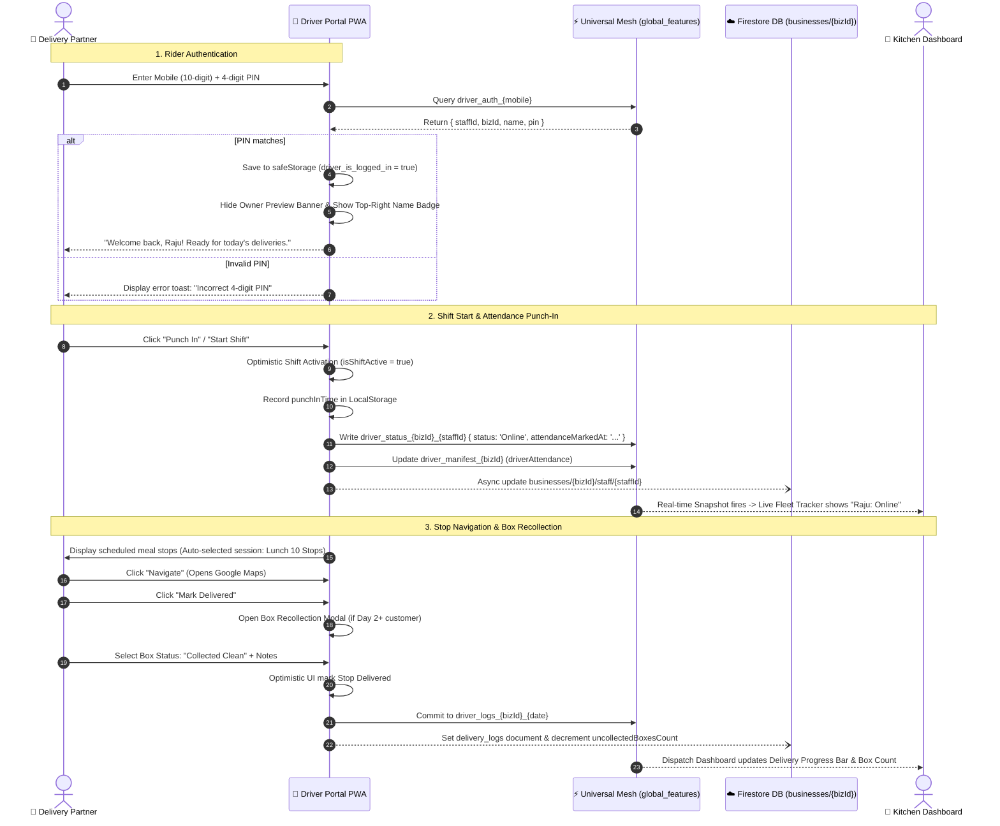
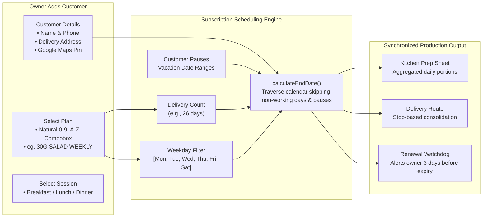
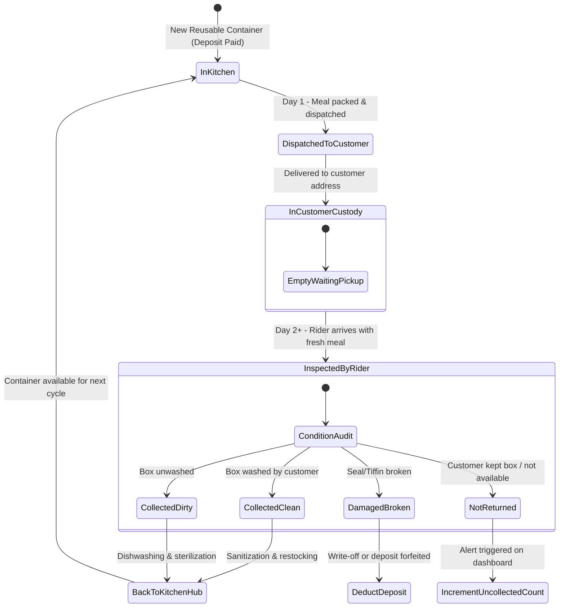

# ScaleKitchen OS — Detailed Architecture Diagrams & Flow Specifications

This document provides visual architectural diagrams, subsystem interaction models, and sequence workflows for the **ScaleKitchen** enterprise SaaS platform.

> **Visual Artifacts Available in this Folder:**
> - Vector Graphic Architecture Diagram: [`ARCHITECTURE_DIAGRAM.svg`](./ARCHITECTURE_DIAGRAM.svg)
> - Interactive HTML Diagram Viewer: [`ARCHITECTURE_DIAGRAM.html`](./ARCHITECTURE_DIAGRAM.html)
> - Full Technical Architecture Reference: [`TECHNICAL_ARCHITECTURE.md`](./TECHNICAL_ARCHITECTURE.md)

---

## 1. System Topology & Tier Architecture (Mermaid)

```mermaid
graph TD
    %% User Layer
    subgraph Client_Layer ["Client & Actor Layer"]
        A1["👑 Kitchen Owner Hub<br/>(React Desktop/Tablet)"]
        A2["👨‍🍳 Kitchen KDS Display<br/>(Prep Sheet Station)"]
        A3["🏢 Branch Dispatch Hub<br/>(Manager Portal)"]
        A4["🛵 Delivery Boy App<br/>(Mobile PWA)"]
        A5["💬 End Customer<br/>(WhatsApp & Web Receipts)"]
    end

    %% Network & Application Layer
    subgraph Application_Layer ["React 18 & Vite Business Engines"]
        B1["📅 Subscription Engine<br/>• 0-9 A-Z Natural Plan Combobox<br/>• Dynamic End-Date Auto Shift<br/>• Vacation / Pause Calendar"]
        B2["📦 Eco-Dabba Tracker<br/>• Day 2+ Recollection Protocol<br/>• Condition Audit (Clean/Dirty/Damage)<br/>• Security Deposit (₹) Ledger"]
        B3["🍳 Kitchen Prep Engine<br/>• KDS Batch Aggregation<br/>• Dietary & VIP Tagging<br/>• Raw Inventory BOM Calculator"]
        B4["🗺️ Route & Fleet Engine<br/>• Stop-Based Grouping (1 Stop/Cust)<br/>• Nearest-Neighbor TSP Optimizer<br/>• OpenStreetMap Live Markers"]
        B5["🧾 Billing & GST Engine<br/>• Tax Invoice PDF & 80mm Thermal<br/>• Daily Cash vs Online Ledger<br/>• Renewal History Auditing"]
    end

    %% Universal Real-Time Bridge
    subgraph Universal_Mesh ["Universal Real-Time Mesh (global_features)"]
        C1["🔑 driver_auth_{phone}<br/>• Mobile & 4-Digit PIN Registry<br/>• Cross-Origin Iframe Safe"]
        C2["📋 driver_manifest_{bizId}<br/>• Real-time Fleet Snapshot<br/>• Zero-Permission Driver Reads"]
        C3["📦 driver_logs_{bizId}_{date}<br/>• Delivery Completed Stream<br/>• Box Recollection Status"]
        C4["📡 driver_status_{bizId}_{staffId}<br/>• Sub-Second GPS Breadcrumbs<br/>• Shift Punch In/Out Status"]
    end

    %% Cloud Database Layer
    subgraph Database_Layer ["Google Cloud Firestore (Permanent Tenant Store)"]
        D1[("🏢 /businesses/{userId}<br/>Root Tenant Document")]
        D2["📁 branches/ (Kitchen Hubs)"]
        D3["📁 plans/ (Subscription Catalog)"]
        D4["📁 customers/ (Subscribers & Addresses)"]
        D5["📁 staff/ (Cooks, Managers & Riders)"]
        D6["📁 delivery_logs/ (Permanent Audit Trail)"]
        D7["📁 invoices/ & expenses/ (P&L Ledger)"]
        D8["🛡️ Cloud Security Rules<br/>(Tenant Isolation & Anti-Tamper)"]
    end

    %% Flow Connections
    A1 --> B1
    A1 --> B4
    A1 --> B5
    A2 --> B3
    A3 --> B4
    A4 --> C1
    A4 --> C3
    A4 --> C4
    A5 -.-> B5

    B1 --> D1
    B2 --> C3
    B3 --> D4
    B4 --> C2
    B5 --> D7

    C1 -.-> D5
    C2 -.-> D4
    C3 -.-> D6
    C4 -.-> D5

    D1 --- D2
    D1 --- D3
    D1 --- D4
    D1 --- D5
    D1 --- D6
    D1 --- D7
    D8 --- D1

    classDef client fill:#1e293b,stroke:#3b82f6,stroke-width:1.5px,color:#fff;
    classDef engine fill:#0f172a,stroke:#06b6d4,stroke-width:1.5px,color:#fff;
    classDef mesh fill:#1c1917,stroke:#f59e0b,stroke-width:2px,color:#fff;
    classDef db fill:#064e3b,stroke:#10b981,stroke-width:2px,color:#fff;

    class A1,A2,A3,A4,A5 client;
    class B1,B2,B3,B4,B5 engine;
    class C1,C2,C3,C4 mesh;
    class D1,D2,D3,D4,D5,D6,D7,D8 db;
```

---

## 2. Delivery Boy Shift & Field Operation Lifecycle (Sequence Flow)

This sequence diagram depicts how a rider logs in with their PIN, marks attendance, navigates stops, and completes deliveries without permission barriers:

---

## 3. Recurring Subscription & Dynamic Scheduling Architecture

---

## 4. Reusable Eco-Container (Dabba) State Machine

---

## 5. Security & Authorization Matrix (RBAC)

| Resource Path | Super Admin | Kitchen Owner | Branch Manager | Delivery Partner | Public |
| :--- | :---: | :---: | :---: | :---: | :---: |
| `/businesses/{userId}` | **Full (R/W)** | **Self Only (R/W)\*** | **Read Only** | **Read Only** | Read (Branding) |
| `.../staff/{id}` | **Full (R/W)** | **Self (R/W)** | **Read** | **Whitelist Update\*\*** | No Access |
| `.../customers/{id}` | **Full (R/W)** | **Self (R/W)** | **Self Branch (R/W)** | **Read / Box Update** | No Access |
| `.../delivery_logs/{id}`| **Full (R/W)** | **Self (R/W)** | **Self Branch (R/W)** | **Create / Update** | No Access |
| `.../invoices/{id}` | **Full (R/W)** | **Self (R/W)** | **Self Branch (R)** | **No Access** | Read (Direct Token) |
| `/global_features/*` | **Full (R/W)** | **Full (R/W)** | **Full (R/W)** | **Self Stream (R/W)** | No Access |
| `/global_settings/*` | **Full (R/W)** | **Read Only** | **Read Only** | **Read Only** | Read Only |

*\* Kitchen Owners cannot extend `planExpiryDate` or reset `trialClaimed` directly in Firestore (governed by anti-tampering rules).*  
*\*\* Delivery Partners can only update: `status`, `currentLat`, `currentLng`, `lastLocationUpdate`, `lastAttendanceDate`, `attendanceMarkedAt`, `batteryLevel`, and `updatedAt`.*
