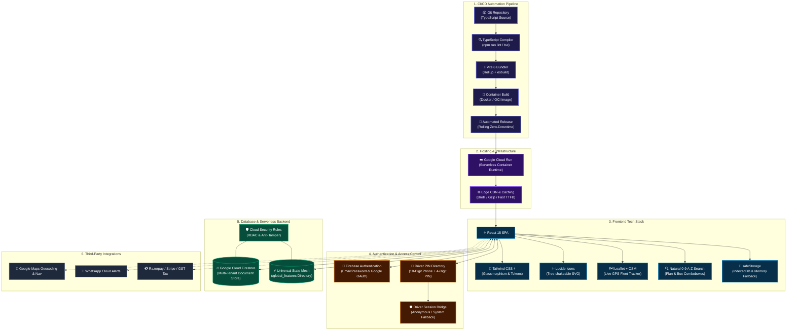

# ScaleKitchen OS — Technology Stack & Engineering Tooling Specification

> **Classification:** Technical Architecture & Tooling Blueprint  
> **Folder:** `Knowme/`  
> **Target Audience:** Engineering Leads, Cloud Architects, Security Auditors & Technical Founders  
>
> **Visual Diagram Artifacts:**
> - 🖼️ **Vector Tech Stack Flow Diagram:** [`TECH_STACK_ARCHITECTURE.svg`](./TECH_STACK_ARCHITECTURE.svg)
> - 🌐 **Interactive Diagram Viewer (Browser):** [`TECH_STACK_ARCHITECTURE.html`](./TECH_STACK_ARCHITECTURE.html)
> - 📊 **Master System Architecture:** [`TECHNICAL_ARCHITECTURE.md`](./TECHNICAL_ARCHITECTURE.md)
> - 🗺️ **Component Interaction & Sequence Diagrams:** [`ARCHITECTURE_DIAGRAM.md`](./ARCHITECTURE_DIAGRAM.md)

---

## 1. High-Level Tech Stack Flow Diagram (Mermaid)

---

## 2. Comprehensive Tooling & Technology Stack Breakdown

### 2.1 Frontend Engineering Stack
| Tool / Technology | Version / Spec | Functional Role in ScaleKitchen |
| :--- | :--- | :--- |
| **React** | `18.3.x` | Core UI library powering the Single Page Application (SPA), component hierarchy, and concurrent state hydration. |
| **TypeScript** | `5.5.x` | Enforces strict static typings across domain entities (`GlobalCustomer`, `SubscribedPlan`, `DeliveryBoyStaff`, `BoxRecollectionStatus`). |
| **Vite** | `6.x` | Modern ESM build tool with Rollup bundler, on-demand compilation, dynamic chunk splitting, and esbuild minification. |
| **Tailwind CSS** | `4.x` | Utility-first CSS engine with modern glassmorphism design tokens (`backdrop-blur-xl`, `shadow-glass`, custom gradient palettes). |
| **Lucide React** | `^0.4x` | Comprehensive SVG icon library used across kitchen prep, route tracking, delivery status, and invoice actions. |
| **Leaflet & OpenStreetMap** | `1.9.x` | Open-source geospatial mapping engine rendering real-time rider GPS breadcrumbs, branch hubs, and delivery stops without API lock-in. |
| **Natural Search Combobox** | Custom Hook | Provides natural `0-9, A-Z` sorting (`localeCompare(..., { numeric: true })`) and real-time substring filtering for Plans and Reusable Box selection. |
| **safeStorage Layer** | Memory + LocalStorage | Prevents browser `SecurityError` exceptions inside cross-origin iframe sandboxes by wrapping `localStorage` with in-memory fallbacks. |

---

### 2.2 Authentication & Identity Management
| Component | Implementation | Security Mechanism |
| :--- | :--- | :--- |
| **Kitchen Owner & Super Admin** | Firebase Auth (Email/Password & Google OAuth) | Standard JWT tokens verified on every Firestore request; tenant scoped by `request.auth.uid == userId`. |
| **Delivery Boy Field Auth** | Universal PIN Mesh (`driver_auth_{phone}`) | 10-digit registered mobile number + 4-digit PIN validated in real-time against `global_features` directory. |
| **Driver System Session** | `driver_session_system@scalekitchen.internal` | Background system credential enabling driver PWAs to maintain authorized read access to manifests even in third-party mobile browsers. |
| **Zero URL Token Exposure** | `window.history.replaceState` | Immediately scrubs sensitive authentication tokens and query parameters from the browser address bar upon arrival. |

---

### 2.3 Database & Real-Time Synchronization
| Layer | Technology | Architectural Purpose |
| :--- | :--- | :--- |
| **Permanent Tenant Storage** | Google Cloud Firestore | Hierarchical NoSQL document store isolating each kitchen owner under `/businesses/{userId}/...`. |
| **Universal Real-Time Mesh** | `/global_features/{featureDoc}` | High-throughput, cross-browser communication bridge for driver manifests (`driver_manifest_{bizId}`), attendance (`driver_status_{bizId}_{id}`), and delivery logs. |
| **Real-Time Data Streaming** | `onSnapshot()` WebSocket Listeners | Powers live kitchen fleet updates, order dispatch progress, and instant box recollection notifications in `< 200ms`. |
| **Atomic Transactions** | `writeBatch()` | Guarantees all-or-nothing execution when generating daily delivery schedules or archiving invoice ledgers. |

---

### 2.4 Hosting & Cloud Infrastructure
| Resource | Platform | Deployment Architecture |
| :--- | :--- | :--- |
| **Frontend & App Hosting** | **Google Cloud Run** | Fully managed serverless container runtime deployed in region `asia-east1`. Automatically scales down to zero when idle and scales up horizontally on peak meal dispatch hours. |
| **Global Edge Delivery** | **Cloud CDN** | Global edge network with HTTP/2, Brotli compression, and distributed caching for static JS/CSS bundles. |
| **Database Clustered Hosting** | **Google Cloud Platform (GCP)** | Multi-zone redundant Firestore clusters with automated continuous backups, 99.999% SLA availability, and automatic failover. |

---

### 2.5 CI/CD Build & Deployment Pipeline
ScaleKitchen utilizes an execute-first, automated CI/CD lifecycle:
1. **Source Code Commit (`Git`):** Code changes are committed to the version-controlled repository with strict TypeScript typing.
2. **Type Checking & Linting (`tsc`):** The pipeline executes `npm run lint` (`tsc`), validating that all imports, types, and schema models conform to strict contracts with zero compilation warnings.
3. **Vite Production Bundler (`vite build`):** The Rollup/esbuild pipeline performs dead-code elimination (tree-shaking), generates asset hashes, and bundles JavaScript into optimized production chunks.
4. **Container Image Packaging (`Docker / OCI`):** Packages production assets into a minimal container image with a lightweight Node.js web server.
5. **Zero-Downtime Deployment (`Cloud Run`):** The container image is rolled out to Google Cloud Run, seamlessly directing new user requests to the updated revision without downtime.

---

### 2.6 Security Architecture & Governance
| Security Layer | Implementation Details |
| :--- | :--- |
| **Tenant Isolation** | Security rules strictly restrict writes to `/businesses/{userId}` where `request.auth.uid == userId` or `isAdmin()`. |
| **Anti-Tampering Guards** | Prevents malicious client scripts from altering `trialClaimed` flags or extending `planExpiryDate` into the future. |
| **Driver Write Boundaries** | Delivery boys have whitelisted update access strictly limited to: `status`, `currentLat`, `currentLng`, `lastLocationUpdate`, `lastAttendanceDate`, `attendanceMarkedAt`, `batteryLevel`, and `updatedAt`. |
| **Cross-Origin Sandbox Safety** | Safe storage wrappers protect against browser partition cookie blocking and iframe sandbox storage errors. |

---

### 2.7 External Integrations & Tooling
- **Google Maps Platform:** Address geocoding, distance matrices, and one-tap turn-by-turn navigation for delivery riders.
- **OpenStreetMap & CartoDB:** High-performance, tile-based interactive map rendering in the Kitchen Dispatch Hub.
- **WhatsApp Cloud API:** Delivery confirmation messages, invoice links, and subscription renewal alerts sent directly to subscribers.
- **Payment Gateways & GST Printing:** Unified support for Razorpay / Stripe online payments, cash tracking, and 80mm thermal receipt printing.
